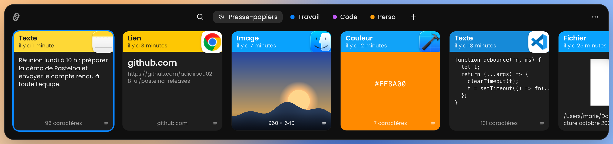
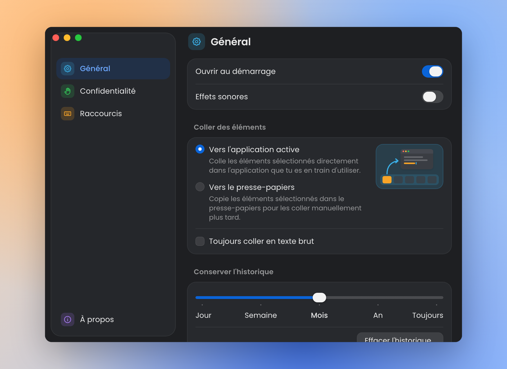

<div align="center">


# PasteIna

**Tout ce que vous copiez, retrouvé en un instant.**<br>
Un gestionnaire de presse-papiers pour Mac, gratuit, léger et 100 % local.

<a href="https://github.com/abibdigitoff/pasteina-releases/releases/latest"></a>

<sub>Gratuit · macOS 12 ou plus récent · Signé et notarisé par Apple</sub>

</div>

---

## Présentation

PasteIna garde en mémoire tout ce que vous copiez : textes, images, liens, fichiers, couleurs. Appuyez sur **⇧⌘V**, un panneau s'ouvre en bas de l'écran avec votre historique. Choisissez une carte, appuyez sur **↩**, c'est collé.

Pas de compte, pas d'abonnement, pas de publicité. Vos données ne quittent jamais votre Mac.

## Captures

<p align="center">
  
</p>

<p align="center">
  
</p>

## Fonctionnalités

**Historique complet**
- Texte, texte mis en forme, images, fichiers, liens et couleurs
- Conservation au choix : un jour, une semaine, un mois, un an ou toujours (jusqu'à 20 000 éléments)
- Fluide même avec plus de 10 000 éléments

**Retrouver**
- Recherche instantanée : tapez quelques lettres, les accents sont ignorés (« cafe » trouve « café »)
- Filtres par type (texte, image, lien, fichier, couleur) et par app d'origine
- Aperçu en grand avec la barre d'espace

**Coller**
- Collage direct dans l'app que vous utilisez, ou simple copie dans le presse-papiers
- Collage rapide avec **⌘1** à **⌘9**
- Collage en texte brut avec **⇧↩** (ou toujours en texte brut, au choix)
- Modifier un texte avant de le coller
- Glisser-déposer une carte vers n'importe quelle app
- Coller plusieurs éléments à la suite

**Organiser**
- Collections (pinboards) pour garder vos textes et images utiles sous la main
- Passer d'une collection à l'autre au clavier
- Réorganiser les collections par glisser-déposer

**Confidentialité**
- Mise en pause de la capture
- Apps ignorées (Mots de passe et Trousseaux d'accès ignorés par défaut)
- Mots de passe et contenus confidentiels ignorés automatiquement
- Tout reste sur votre Mac

**Au quotidien**
- Fonctionne au-dessus des apps en plein écran et sur tous les bureaux
- Ouverture au démarrage du Mac
- Effets sonores
- Sauvegarde et restauration de l'historique
- Mises à jour automatiques

## Installation

1. **Téléchargez** le fichier `.dmg` depuis la [dernière version](https://github.com/abibdigitoff/pasteina-releases/releases/latest).
2. **Ouvrez-le** et glissez PasteIna dans le dossier **Applications**.
3. **Lancez PasteIna** depuis le dossier Applications.

Au premier lancement, PasteIna vous guide en trois étapes. Il vous demande l'autorisation **Accessibilité** : elle lui permet de coller directement dans l'app active (il simule ⌘V pour vous). Un bouton ouvre le bon réglage ; activez PasteIna dans **Réglages Système → Confidentialité et sécurité → Accessibilité**.

Sans cette autorisation, PasteIna fonctionne quand même : l'élément choisi est copié et il vous suffit de faire ⌘V.

L'icône de PasteIna apparaît dans la barre des menus, en haut à droite de l'écran.

## Raccourcis clavier

| Raccourci | Action |
| --- | --- |
| **⇧⌘V** | Ouvrir ou fermer PasteIna (partout) |
| ← → | Passer d'une carte à l'autre |
| ↩ | Coller l'élément sélectionné |
| ⇧↩ | Coller en texte brut |
| ⌘1 … ⌘9 | Coller directement la carte n° 1 à 9 |
| Espace | Aperçu en grand |
| ⌘E | Modifier avant de coller |
| ⌘C | Copier sans coller |
| ⌘⌫ | Supprimer l'élément |
| Tapez du texte, ou ⌘F | Rechercher |
| ⌘→ / ⌘← | Collection suivante / précédente (ou ⇥ / ⇧⇥) |
| ⌘N | Écrire un nouvel élément texte |
| ⌘, | Ouvrir les réglages |
| esc | Effacer la recherche, puis fermer |

Les raccourcis principaux se changent dans **Réglages → Raccourcis** : ouverture du panneau, changement de collection, touche du collage rapide (⌘, ⌥ ou ⌃) et touche du texte brut (⇧ ou ⌥).

Clic droit sur une carte : ranger dans une collection, supprimer… Clic droit sur une collection : renommer ou supprimer.

## Confidentialité

- **Tout reste sur votre Mac.** L'historique est enregistré dans `~/Library/Application Support/com.pasteina.desktop/`.
- **Aucun compte, aucune statistique, aucun pistage.**
- **Une seule connexion réseau** : la vérification des mises à jour auprès de GitHub.
- Les contenus marqués comme confidentiels ou temporaires par les autres apps (par exemple les gestionnaires de mots de passe) ne sont **jamais enregistrés**.

Les détails sont dans la [politique de confidentialité](PRIVACY.md).

## PasteIna ou Paste ?

[Paste](https://pasteapp.io) est une excellente app, plus complète, et payante par abonnement. PasteIna en reprend l'essentiel, gratuitement, avec une app beaucoup plus légère.

| | Paste | PasteIna |
| --- | --- | --- |
| Prix | Abonnement | **Gratuit** |
| Taille de l'app | 33 Mo | **6,6 Mo** (DMG : 3,2 Mo) |
| Mémoire utilisée | ~330 Mo | **~75 Mo** |
| Synchronisation iCloud | Oui | Non |
| App iPhone / iPad | Oui | Non |
| Données | Locales + iCloud (si activé) | **Uniquement locales** |

Mesures réalisées le 27 octobre 2026 sur un Mac Apple Silicon. Méthode et détails dans le [comparatif complet](docs/COMPARATIF.md).

## Questions fréquentes

<details>
<summary><strong>PasteIna est-il vraiment gratuit ?</strong></summary>

Oui. Pas d'abonnement, pas de version payante, pas de publicité. Usage personnel et professionnel autorisé. Voir la [licence](LICENSE).
</details>

<details>
<summary><strong>Fonctionne-t-il sur les Mac Intel ?</strong></summary>

Oui. PasteIna est une app universelle : elle fonctionne sur les Mac Apple Silicon (M1, M2, M3, M4…) comme sur les Mac Intel. Il faut macOS 12 Monterey ou plus récent.
</details>

<details>
<summary><strong>Mon historique est-il synchronisé avec iCloud ?</strong></summary>

Non. PasteIna ne synchronise rien : votre historique reste sur ce Mac. C'est un choix de confidentialité. La synchronisation entre plusieurs Mac est une idée pour après la 1.0.
</details>

<details>
<summary><strong>Où sont mes données ?</strong></summary>

Dans `~/Library/Application Support/com.pasteina.desktop/` : l'historique (`history.sqlite`), les images, les icônes des apps, vos réglages (`settings.json`) et le journal d'erreurs (`logs`). Pour ouvrir ce dossier : dans le Finder, **Aller → Aller au dossier…** (⇧⌘G) puis collez le chemin.
</details>

<details>
<summary><strong>Comment effacer mon historique ?</strong></summary>

**Réglages → Général → Effacer l'historique…** Les éléments rangés dans vos collections ne sont pas concernés.
</details>

<details>
<summary><strong>Pourquoi PasteIna demande-t-il l'autorisation Accessibilité ?</strong></summary>

Pour coller à votre place dans l'app active, PasteIna simule la frappe de ⌘V. macOS exige l'autorisation Accessibilité pour cela. PasteIna ne lit pas ce que vous tapez et ne contrôle rien d'autre.
</details>

<details>
<summary><strong>Comment désinstaller complètement PasteIna ?</strong></summary>

1. Désactivez **Réglages → Général → Ouvrir au démarrage**, puis quittez PasteIna (icône de la barre des menus → **Quitter PasteIna**).
2. Mettez **PasteIna** à la corbeille depuis le dossier Applications.
3. Supprimez ses données en collant ces commandes dans le Terminal :

```sh
rm -rf ~/Library/Application\ Support/com.pasteina.desktop
rm -rf ~/Library/Caches/com.pasteina.desktop
rm -rf ~/Library/WebKit/com.pasteina.desktop
rm -f  ~/Library/LaunchAgents/PasteIna.plist
tccutil reset Accessibility com.pasteina.desktop
```

La première ligne efface votre historique et vos collections : c'est définitif. La dernière retire PasteIna de la liste Accessibilité.
</details>

<details>
<summary><strong>J'ai trouvé un problème, ou j'ai une idée</strong></summary>

Ouvrez un [ticket sur GitHub](https://github.com/abibdigitoff/pasteina-releases/issues) en décrivant ce qui s'est passé et votre version de macOS.
</details>

## Liens

- [Télécharger la dernière version](https://github.com/abibdigitoff/pasteina-releases/releases/latest)
- [Lien direct vers le .dmg](https://github.com/abibdigitoff/pasteina-releases/releases/latest/download/PasteIna.dmg)
- [Nouveautés (CHANGELOG)](CHANGELOG.md)
- [Politique de confidentialité](PRIVACY.md)
- [Licence](LICENSE)
- [Comparatif avec Paste](docs/COMPARATIF.md)
- [Signaler un problème](https://github.com/abibdigitoff/pasteina-releases/issues)

---

<div align="center">
<sub>© 2026 ABIB DIGIT · PasteIna n'est pas affilié à Paste ni à ses éditeurs.</sub>
</div>
